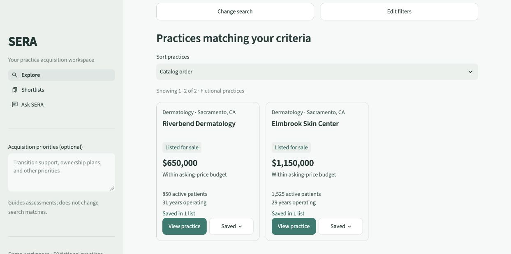
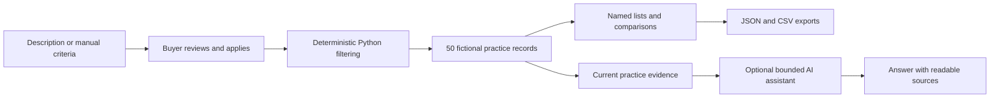

# SERA

A local workspace for exploring medical and dental practice acquisitions, building shortlists, and working through commercial property decisions.

**Portfolio demo · 50 fictional practices · Single-user local application**

Every listing, address, financial figure and source reference is invented. SERA does not search live listings, establish valuations or complete due diligence. Its optional AI assistant can make unsupported interpretations even when citations are valid; verify its answers against the displayed records.



## What you can do

- **Explore:** describe an ideal practice or set filters manually, review criteria before applying them, and sort matching practices by name or price. Exact Python filtering determines matches; acquisition priorities do not change them.
- **Inspect:** view financials, staffing, patient information, premises, disclosures and source details. Practice asking prices remain separate from property prices and occupancy costs.
- **Shortlist:** save practices to named lists, compare two or three candidates, and export the whole list as JSON or CSV. Saved memberships persist locally across restarts.
- **Ask SERA:** review an acquisition, compare leasing versus buying, or assess a property's suitability. Attach up to three practices for a tailored discussion. Starter buttons prepare editable questions; only **Send** starts a request.

The catalog includes 40 leased and 10 owned-premises scenarios. One practice price is intentionally undisclosed. Other inapplicable fields, such as lease terms for owned premises, remain inapplicable.

## Run locally

Use **Python 3.14**. A fresh isolated installation was verified on macOS with Python 3.14, including a clean dependency check, 183 passing tests, lint and formatting. These commands also use the usual Linux environment syntax; Linux and Windows installation have not been independently verified.

```sh
python3.14 -m venv .venv
source .venv/bin/activate
python -m pip install -r requirements.txt
cp -n .env.example .env
python -m streamlit run app.py
```

Open the local URL printed by Streamlit. **Manual search, practice details, shortlists, comparison and exports work without a model service.** Follow the [five-minute demo walkthrough](docs/DEMO.md) to try them.

For optional AI features, install and start Ollama, then download the configured model:

```sh
ollama pull qwen3:8b
```

The example configuration uses local inference. SERA rejects remote Ollama addresses and cloud model tags. It never silently switches a failed local request to a paid provider. The optional OpenAI route requires changing `SERA_AI_PROVIDER` and supplying your own private key in `.env`; API use can incur charges.

Keep `.env` private. Set `SERA_DATA_DIR` to a private local folder if you want to isolate saved lists; otherwise they live in ignored `local_data/saved_lists.json`. Conversations and assessments last only for the current browser session. Never commit real buyer information or exported working notes.

## How it works



Streamlit provides the Explore, Shortlists and Ask SERA screens. Pydantic validates catalog data and storage. Python owns filtering, record identity, persistence and exports. Natural-language filter suggestions are reviewed before application; the model never generates search code or SQL.

For selected practices, Python retrieves the current records before synthesis. Open-ended discovery uses read-only LangChain tools. Investigations have a 60-second overall limit and at most one corrective revision. Specific evidence failures or incomplete synthesis retain recorded facts while withholding the recommendation. This reduces certain failure modes; it does not prove semantic accuracy.

Named-list writes are validated, atomic and serialized between cooperating local processes. Stale edits are rejected and damaged files are preserved. These protections are for a local demo, not an authenticated multi-user service.

## Development and verification

```sh
python -m pip install -r requirements-dev.txt
PYTEST_DISABLE_PLUGIN_AUTOLOAD=1 python -m pytest tests -q
python -m ruff check app.py sera screens scripts tests
python -m ruff format --check app.py sera screens scripts tests
python scripts/evaluate.py
```

Tests use isolated storage and controlled model responses. The offline evaluation skips cases requiring a live model. Neither passing tests nor correct source identifiers establish that an AI recommendation is reliable. See [VERIFICATION.md](VERIFICATION.md) for actual results, browser checks and observed AI errors, and [PRODUCT_REVIEW.md](PRODUCT_REVIEW.md) for design decisions.

## Scope and limits

This release is a local product demo, with no accounts, public multi-user hosting, authorized live listing feed or ongoing observability service. Public deployment requires authentication and separate user storage. AI financial, legal and property interpretations require independent review; seller-reported revenue is not profit, and an unverified disclosure is not clearance.

Licensed under [MIT](LICENSE).
