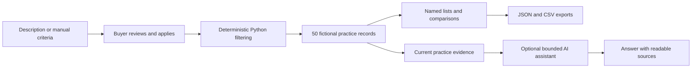

# SERA

[](https://github.com/shefali-parmar/sera-acquisition-workspace/actions/workflows/checks.yml)

**[Open the public SERA demo](https://sera-acquisition-workspace.streamlit.app/)**

A workspace for exploring medical and dental practice acquisitions, building shortlists, and working through commercial property decisions.

**Portfolio demo · 50 fictional practices · Local and public-demo modes**

Every practice listing, address, financial figure and seller-source reference is invented. SERA does not search live listings, establish valuations or complete due diligence. Its optional AI assistant can make unsupported interpretations even when citations are valid; verify its answers against the displayed records.


## What you can do

- **Explore:** describe an ideal practice or set filters manually, review criteria before applying them, and sort matching practices by relevance, distance, name or price. Exact Python filtering determines matches; acquisition priorities do not change them.
- **Inspect:** view financials, staffing, patient information, premises, disclosures and source details. Practice asking prices remain separate from property prices and occupancy costs.
- **Shortlist:** save practices to named lists, compare two or three candidates, and export the whole list as JSON or CSV. Local memberships persist across restarts; public-demo memberships remain private to the current visit.
- **Ask SERA:** review an acquisition, compare leasing versus buying, or assess a property's suitability. Attach up to three practices for a tailored discussion. Starter buttons prepare editable questions; only **Send** starts a request.

The catalog includes 40 leased and 10 owned-premises scenarios. One practice price is intentionally undisclosed. Other inapplicable fields, such as lease terms for owned premises, remain inapplicable.

## Run locally

Use **Python 3.14**. The current release passed 300 tests on Ubuntu 24.04; local checks also passed in an isolated macOS environment. See [verification results](VERIFICATION.md) for exact checks. Windows installation has not been independently verified.

```sh
python3.14 -m venv .venv
source .venv/bin/activate
python -m pip install -r requirements.txt
cp -n .env.example .env
python -m streamlit run app.py
```

Open the local URL printed by Streamlit. **Manual search, practice details, shortlists, comparison and exports work without a model service.** Follow the [five-minute demo walkthrough](docs/DEMO.md) to try them.

For optional AI features, install and start Ollama, then download the configured model:

```sh
ollama pull qwen3:8b
```

The example configuration uses local inference. SERA rejects remote Ollama addresses and cloud model tags. It never silently switches a failed local request to a paid provider. To use Gemini, set `SERA_AI_PROVIDER=gemini`, `GEMINI_API_KEY` and optionally `GEMINI_MODEL` (default: `gemini-3.5-flash-lite`). OpenAI is also supported with `SERA_AI_PROVIDER=openai` and `OPENAI_API_KEY`. Store local keys in `.env`; API use can incur charges.

Keep `.env` private. Set `SERA_DATA_DIR` to a private local folder if you want to isolate saved lists; otherwise they live in ignored `local_data/saved_lists.json`. Conversations and assessments last only for the current browser session. Never commit real buyer information or exported working notes.

## Public demo hosting

Deploy this repository's `main` branch and `app.py` on Streamlit Community Cloud with Python 3.14. In the hosting provider's **private Secrets settings**, configure:

```toml
SERA_PUBLIC_DEMO = "true"
SERA_AI_PROVIDER = "gemini"
GEMINI_MODEL = "gemini-3.5-flash-lite"
GEMINI_API_KEY = "replace_with_your_private_key"
```

Enter the real key only in private settings. Never commit it or put it in a URL. Gemini uses the Developer API explicitly; it does not fall back to ambient Google credentials or another provider. A missing key disables AI while manual browsing and shortlists remain available.

Public mode uses session storage and never reads or writes the local saved-list file. Each visitor's lists and conversations last for that visit; export them before reloading or closing the page. There are no accounts or cross-device recovery. Public questions and selected fictional evidence are sent to the configured AI provider; avoid entering confidential information.

AI actions have a 10-second cooldown, 10 requests per visit and 100 requests per server process per UTC day. `SERA_PUBLIC_AI_SESSION_LIMIT` and `SERA_PUBLIC_AI_DAILY_LIMIT` can lower those allowances (maximum configurable values: 100 and 1,000). Failed requests count. Starting a new conversation does not reset the visit allowance. These are demo safeguards, **not a billing ceiling**: sessions and server restarts reset counters, and one action can include several bounded model calls. Set provider-side quotas separately. All existing evidence checks and request deadlines still apply.

## How it works



Relevance orders eligible practices using equally weighted active signals: keyword placement, asking-price headroom, surplus above selected minimums (capped at twice each minimum), and proximity when an origin resolves. Without active signals, ties sort by name and ID. This is a transparent sorting aid, not an AI confidence or investment-quality score; acquisition priorities never affect it.

Distance accepts a ZIP code, city and state, or state. ZIPs take precedence; otherwise the selected city or single state supplies the origin. A radius of 1–10,000 miles replaces exact city/state restrictions, preserving all other criteria. Distance sorting appears once an origin resolves; cards show approximate straight-line miles to each practice's city center. No driving routes or actual practice addresses are implied. [Census source and location limitations](docs/GEOGRAPHY.md).

Streamlit provides the Explore, Shortlists and Ask SERA screens. Pydantic validates catalog data and storage. Python owns filtering, record identity, persistence and exports. Natural-language filter suggestions are reviewed before application; the model never generates search code or SQL.

For selected practices, Python retrieves the current records before synthesis. Open-ended discovery uses read-only LangChain tools. Investigations have a 60-second overall limit and at most one corrective revision. Specific evidence failures or incomplete synthesis retain recorded facts while withholding the recommendation. This reduces certain failure modes; it does not prove semantic accuracy.

Python also calculates a **Recorded criteria check** from captured filters and supported explicit budget/patient-count changes. Strict price boundaries, missing prices and known failures remain visible separately from the model's interpretation. Narrow record checks catch attributable numeric discrepancies, misplaced citations, reversed metric comparisons and unsupported assurances. Complex prose, derived calculations and subjective rankings still require review; these checks are not a general semantic fact checker. See the [recommendation review](docs/RECOMMENDATION_REVIEW.md) for the tested cases and limits.

Local named-list writes are validated, atomic and serialized between cooperating processes. Stale edits are rejected and damaged files are preserved. Public session storage retains the same validation and stale-edit checks without sharing lists between visitors.

## Development and verification

```sh
python -m pip install -r requirements-dev.txt
PYTEST_DISABLE_PLUGIN_AUTOLOAD=1 python -m pytest tests -q
python -m ruff check app.py sera screens scripts tests
python -m ruff format --check app.py sera screens scripts tests
python scripts/evaluate.py
```

Tests use isolated storage and controlled model responses. The offline evaluation skips cases requiring a live model. Neither passing tests nor correct source identifiers establish that an AI recommendation is reliable. See [VERIFICATION.md](VERIFICATION.md) for actual results, browser checks and observed AI errors, and [PRODUCT_REVIEW.md](PRODUCT_REVIEW.md) for design decisions.

## Scope and limits

This release is a fictional product demo, with no accounts, authorized live listing feed or ongoing observability service. Public mode provides ephemeral visitor isolation; persistent private workspaces would require authentication and durable user storage. AI financial, legal and property interpretations require independent review; seller-reported revenue is not profit, and an unverified disclosure is not clearance.

Licensed under [MIT](LICENSE).
