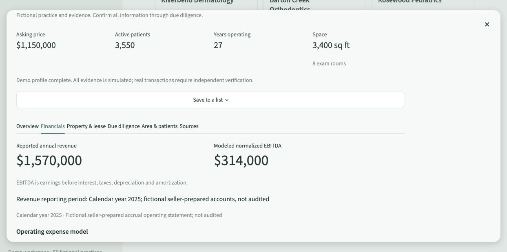
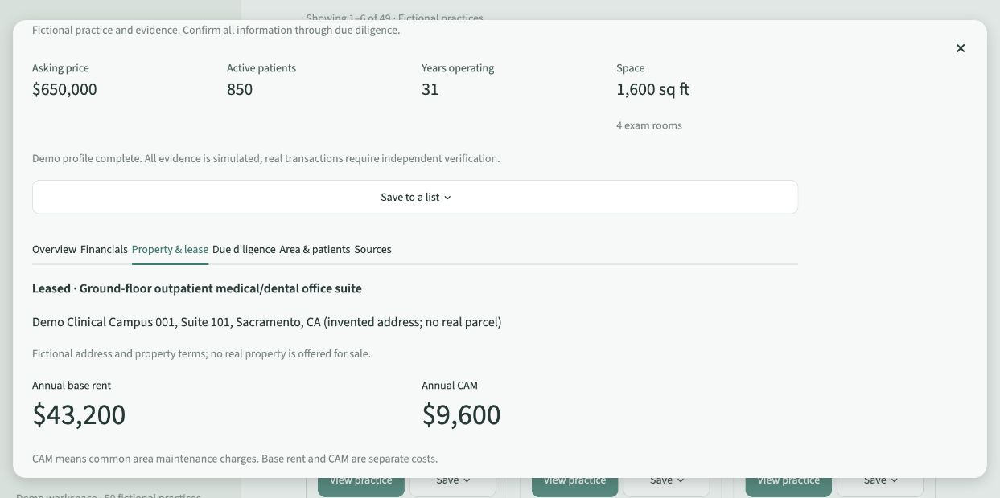
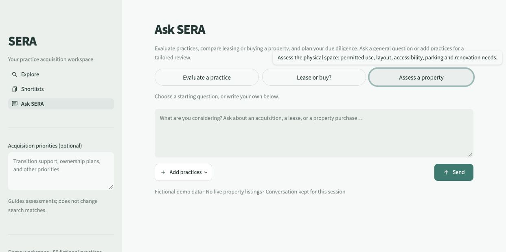

# SERA demo walkthrough

This walkthrough uses fictional catalog records. The first journey needs no model, API key or internet access after installation. The optional second journey demonstrates AI interaction, not validated acquisition advice.

## Five-minute product journey — no AI required

1. Start SERA using the [README instructions](../README.md). In **Explore**, choose **Set filters manually**.
2. Select **Dermatology** and **California**. Enable **Use a maximum asking price**, enter **1500000**, and leave undisclosed prices excluded. Apply the criteria. Riverbend Dermatology and Elmbrook Skin Center should match. Opening a criteria chip returns to review; changes affect results only after Apply.
3. Choose **View practice** on Riverbend. Inspect **Financials**, **Property & lease**, and **Sources**. Its practice asking price is $650,000; annual base rent is $43,200 and annual CAM is $9,600. These are different measures, not interchangeable prices.
4. Use **Save to a list** in the profile, or **Save** on the card. Create a list named **California dermatology** and save Riverbend. Save Elmbrook to the same list. The Save/Saved controls manage membership; opening Saved does not remove a practice.
5. Open **Shortlists** and choose the list. Select both candidates and choose **Compare selected**. Compare each column's values and reporting periods. No AI interpretation is needed for this factual comparison.
6. Open **List actions → Export list** and download JSON or CSV. Both exports cover the entire list. Reopen a file to inspect the two named records and their evidence. Restarting SERA should retain the saved list; conversation history does not persist across restart.

See the [example shortlist with both candidates](images/shortlists.jpg).

**Useful edge case:** browse with **Include undisclosed prices** enabled to see the intentionally undisclosed practice price. It cannot establish budget fit; price sorting places it last in either direction.

The images above show fictional profile examples. Revenue and modeled EBITDA are not verified net income or a valuation. Property details do not establish legal suitability or completed consent.

## Optional AI journey

Start Ollama with the configured model before trying this section. Response times and quality vary; a request may return recorded facts only if interpretation cannot complete within the safeguards.

1. In **Explore**, enter: “Find dermatology practices in California under $1.5 million. Include succession opportunities.” Choose **Suggest editable filters**. Review the proposed state, specialty, strict cap and availability before applying. Compare the proposal with what you asked; correct it if necessary. “Under” excludes the exact cap; “up to” includes it.
2. Open **Ask SERA**. Hover or keyboard-focus a starter to read its definition. **Evaluate a practice** concerns the business; **Lease or buy?** concerns occupancy strategy; **Assess a property** concerns the physical premises.
3. Choose **Lease or buy?**. It prepares a short editable draft without submitting. Review it, add your own assumptions if desired, then choose **Send**. With no practice attached, use this as a general process discussion rather than a claim about a specific listing or current market rate.
4. Choose **Start a new conversation**, then **Add practices**, select Riverbend Dermatology, and apply the selection. Targets are fixed after the first exchange. Ask: “What are Riverbend's annual base rent and CAM, and what landlord consent should I confirm?” Check the response against the **Property & lease** tab and source details. The recorded values are $43,200 and $9,600; landlord consent requires verification.
5. In **Shortlists**, select two or three saved practices, choose **Compare selected**, then **Compare with SERA** for an evidence-based assessment. Recorded facts use practice names and readable source labels; the interpretation section is titled **SERA's Interpretation**. Full reference IDs remain under Source details.
6. Follow up with a question, then use **Export working notes** to retain the visible conversation and its captured scope. **Start a new conversation** starts a fresh exchange.

Acquisition priorities guide assessments without changing deterministic search matches. Selected practices, supplied criteria and priorities inform the assistant; they do not turn a model's recommendation into completed due diligence.

## What this demonstration does not establish

The assistant has produced unsupported judgments and wording stronger than the recorded evidence in development checks. A source citation can be valid while the surrounding interpretation is mistaken. Treat financial comparisons, legal interpretations and property recommendations as working material to verify. The complete observations and controlled checks are recorded in [VERIFICATION.md](../VERIFICATION.md).
